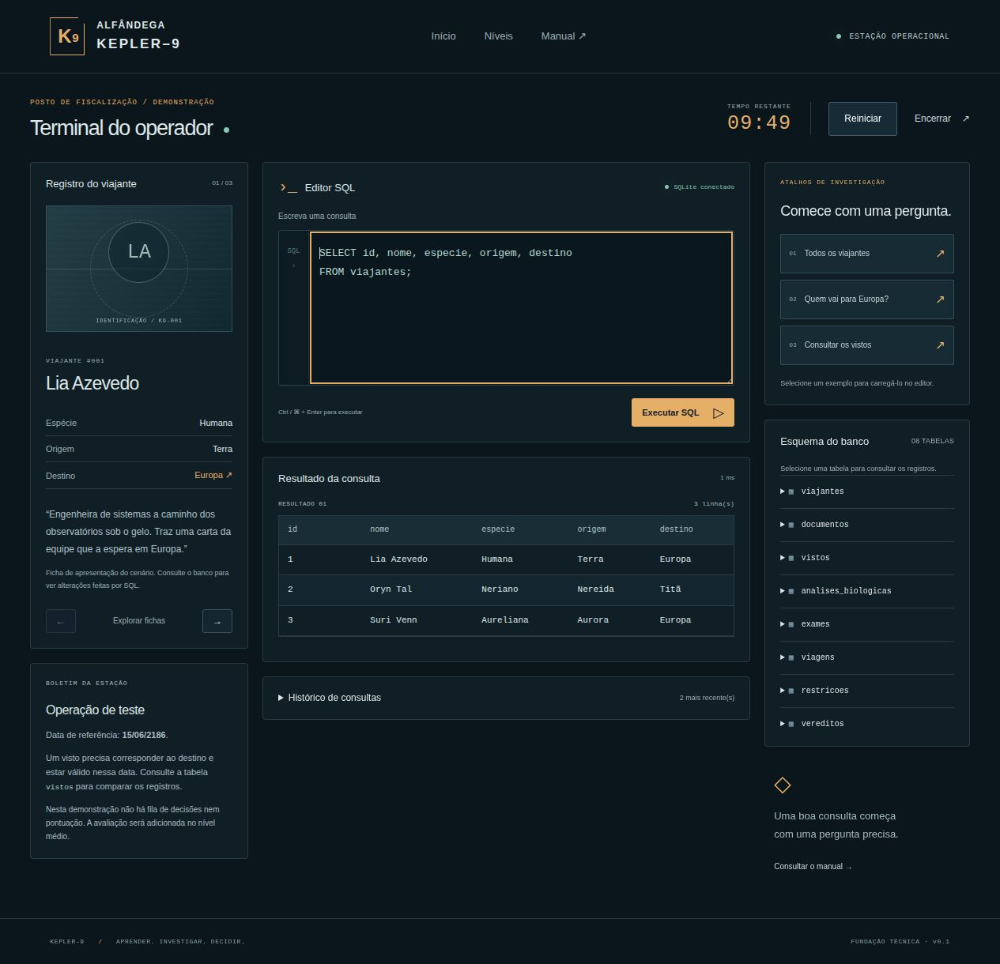

# Validação da Parte 1

Verificação realizada em 17/11/2026. A aplicação foi conferida a partir dos arquivos gerados por `npm run build`, servidos localmente por HTTP.

## Verificações automatizadas

- Instalação reproduzível com `npm ci` a partir do lock. Neste ambiente a instalação usou o cache npm local porque o terminal não tinha acesso de rede.
- Checagem TypeScript por `npm run check`.
- Build de produção por `npm run build`, incluindo bundle do worker e arquivo WASM local.
- Testes em `tests/engine.test.ts`: oito tabelas sem gabarito, filtros e junções reais, descarte de alterações parciais em erro, checkpoints e isolamento entre bancos, chaves estrangeiras, limite compartilhado de linhas, limite de comandos e tamanho de script, transações e normalização de células.
- Testes em `tests/client.test.ts`: cancelamento, timeout, recriação do worker, preservação do último estado concluído, erro de SQL recuperável, reinício e rejeição de operações concorrentes. O transporte é simulado; a engine e os dados usam SQLite real.
- Testes em `tests/session.test.ts`: apresentação sem contagem, expiração por tempo decorrido, encerramento idempotente, nova sessão, contrato de avaliação, escape de HTML e explicações de erros em português.

## Verificações no navegador

| Fluxo | Resultado observado |
| --- | --- |
| Início → apresentação → assumir posto | Carregou o SQLite e iniciou o relógio em 10:00 |
| Consulta inicial | Exibiu os três viajantes em uma tabela |
| Consulta inválida | Mostrou erro sem perder o banco ou o resultado anterior |
| `UPDATE` seguido de `SELECT` | Exibiu o dado alterado |
| Consulta recursiva longa, cancelamento manual | Interrompeu a execução e recuperou o worker |
| Nova consulta após cancelamento | Retornou a alteração concluída antes do cancelamento |
| Consulta longa sem cancelamento manual | Foi interrompida automaticamente após cinco segundos |
| Reinício → assumir posto → consulta | Restaurou nome original, três viajantes e cronômetro |
| Ctrl + Enter no editor | Executou a consulta |
| Manual | Abriu diálogo com foco no botão fechar; Escape fechou o diálogo |
| Encerrar | Abriu resumo com execuções e tempo restante |
| Tela de 390 × 844 | Terminal utilizável; página sem excesso de largura; tabela com rolagem própria |

A expiração da sessão completa foi validada por teste de unidade com timestamps, sem aguardar dez minutos no navegador. O ajuste de dificuldade e de tempos com jogadores permanece para etapas futuras. O teste em tela pequena é uma simulação de viewport, sem teste em aparelho físico. Não houve publicação externa.

O build pode emitir avisos de externalização de `fs`, `path` e `crypto` do adaptador Node de sql.js. Esses ramos não são usados no worker do navegador; o carregamento do WASM e a execução real foram verificados no build servido por HTTP.
