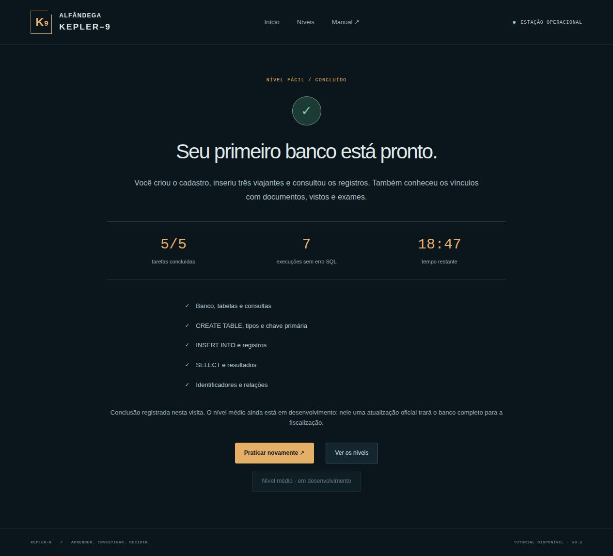

# Validação da Parte 2 — Nível fácil

Conferência realizada em 17/11/2026 no build de produção servido localmente por HTTP. Nenhuma publicação externa foi feita.

## Testes automatizados

`npm test` inclui o conjunto anterior e os casos novos de `tests/tutorial.test.ts`, além da cobertura de troca de modo em `tests/client.test.ts`.

| Área | Comportamento verificado |
| --- | --- |
| Inicialização | Modo fácil sem tabelas, catálogo vazio e demonstração preservada |
| Fluxo completo | Os cinco exemplos exibidos permitem chegar ao encerramento por conclusão |
| Esquema | Caixa, ordem e afinidades equivalentes aceitas; campos e tipos incorretos rejeitados |
| Dados | Fichas completas comparadas; registros ausentes, incorretos ou extras bloqueiam o avanço |
| Resultado | SELECT incompleto não passa; resultados completos com colunas, linhas e aliases diferentes passam |
| Associação | Valores corretos trocados entre viajantes são rejeitados |
| Correção | Scripts de recuperação reconstroem ou preenchem o cadastro do exercício |
| Recuperação | Checkpoints mantêm o banco e o modo; timeout não carrega a demonstração no tutorial |
| Progresso | Sem duplicação de tarefas, sem aceitar feedback de outra tarefa e com limite de três dicas |
| Tempo e reinício | Expiração e encerramento manual impedem avanço; nova tentativa começa zerada |
| Interface | Fácil disponível; médio e avançado indisponíveis; glossário e avanço condicionado renderizados |

Também foram executados `npm run check`, `npm run build` e conferência do diff. Os avisos de externalização de módulos Node de sql.js já descritos na Parte 1 permanecem; o worker e o WASM locais foram exercitados no navegador.

## Percurso no navegador

- Entrada pelo cartão do nível fácil e apresentação com vinte minutos e banco vazio.
- Primeira consulta retornou a coluna `name` sem linhas e liberou a tarefa seguinte.
- Criação de uma tabela incorreta manteve o avanço bloqueado.
- Abertura de dica e carregamento do SQL de correção permitiram continuar sem reiniciar o tempo.
- Cadastro dos três viajantes executou o exemplo completo e passou na conferência dos dados.
- Consulta somente do nome foi rejeitada pelo objetivo de seis campos.
- Consulta com caixa diferente e colunas e linhas reordenadas foi aceita via Ctrl + Enter.
- Consulta final de ids e nomes passou; o glossário de compatibilidade biológica abriu com sua explicação.
- Conclusão mostrou 5/5 tarefas e o resumo dos conteúdos aprendidos.
- Retorno à seleção exibiu a conclusão nesta visita e manteve o nível médio indisponível.
- Nova tentativa e botão Reiniciar restauraram tarefa inicial, validação pendente, banco vazio e 20:00.
- Em viewport de 390 × 844, a página permaneceu sem excesso de largura; editor, resultado e avanço ficaram utilizáveis.
- Ao voltar à demonstração, ela carregou três viajantes, oito tabelas de referência e dez minutos, sem o painel de tarefas.

A expiração completa foi conferida por timestamps nos testes, sem esperar vinte minutos no navegador. O viewport pequeno é uma simulação, sem teste em aparelho físico. Não houve avaliação de duração ou de dificuldade com jogadores reais. A conclusão ainda é mantida apenas em memória; persistência está prevista na Parte 5.
