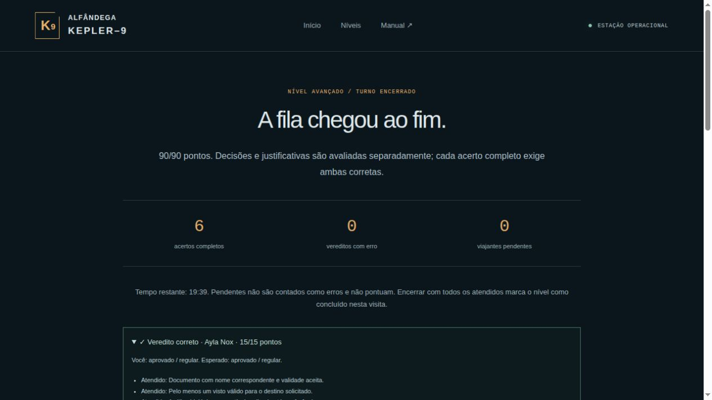

# Validação da Parte 4 — Nível avançado

Validação em 17/11/2026 por testes, TypeScript, build e navegador local. Nenhuma publicação externa foi feita.

`tests/advanced.test.ts` cobre o percurso de seis casos com 90 pontos, os recursos obrigatórios, exame ausente com NULL, duplicatas de exames e multiplicação de linhas em junções. As consultas de referência devolvem dois exames distintos para Ena e dois destinos para Fenn, apesar de duplicatas. O teste rejeita resultado literal com palavras em comentário, não confunde alias COUNT com função e aceita JOIN equivalente. Checkpoints não podem cruzar médio e avançado, e o histórico confirmado continua protegido.

No navegador foram verificados: entrada do avançado, dica contextual, consulta de vistos, exame obrigatório ausente, os seis objetivos, inserção e confirmação de todos os vereditos e resumo com seis acertos, nenhum erro, nenhum pendente e 90/90 pontos. Os fluxos do fácil e médio continuam cobertos pelo conjunto anterior de testes. A campanha em sequência e a persistência serão novamente conferidas na Parte 5.

Não houve avaliação de dificuldade com jogadores nem teste em aparelho físico. As durações continuam preliminares. O progresso ainda é apenas em memória nesta etapa.
