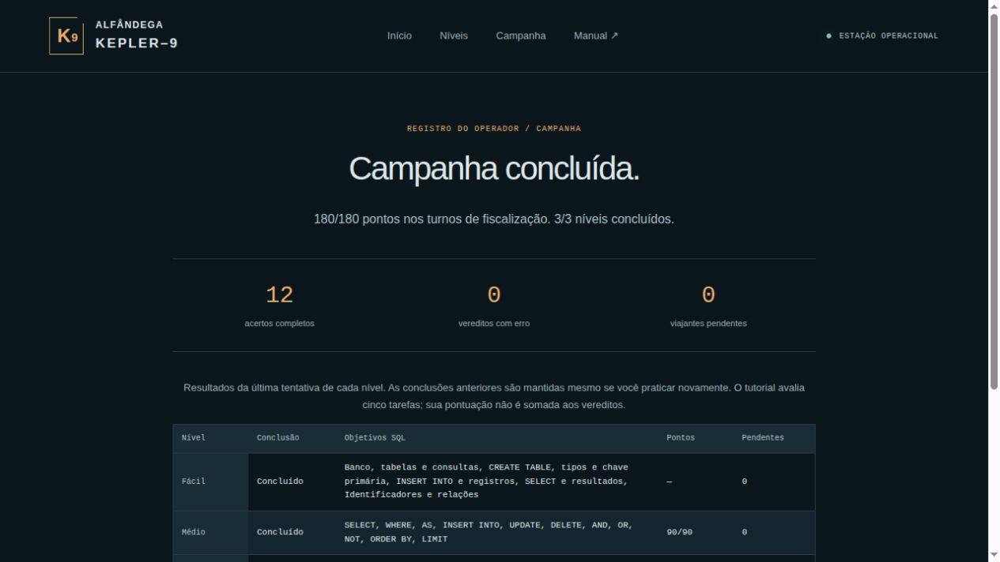

# Validação da Parte 5 — versão 1.0.0

## Entrega

Campanha completa com três níveis, resultado consolidado, salvamento local versionado, retomada do banco/objetivos/rascunhos/relógio e recuperação de dados incompatíveis. Reiniciar um nível preserva os demais resultados; reiniciar a campanha exige confirmação. O build inclui o SQLite WASM e worker locais. Scripts geram e verificam o pacote estático, com instruções e configuração de hospedagem.

## Verificações executadas

- `npm test`: sete arquivos de testes aprovados, cobrindo tutorial, sessão, cliente/recuperação, execução SQL, proteção, médio, avançado e persistência (os agrupamentos se sobrepõem).
- `npm run check`, `npm run build` e `npm run verify:build`: tipos e build aprovados; worker, WASM, assets e licença presentes.
- Persistência com SQLite real: roundtrip dos quatro modos, prefixo do tutorial, versões e formato inválidos, tags incompatíveis, banco oficial adulterado, recibos avançados e falha de armazenamento preservando o último salvamento. Limpeza/reinício do armazenamento cobertos por teste automatizado.
- Relógio restaurado com timestamps controlados: tempo não reinicia e turno vencido bloqueia avanço. Não foi necessário esperar quinze/vinte minutos no navegador para esse teste.
- Limites: 33 colunas e banco de mais de 4 MB rejeitados sem substituir o checkpoint anterior.
- Partida completa no build de produção, servida por HTTP local: fácil, seis viajantes médios e seis avançados, concluindo 180/180 pontos, 12 acertos completos, zero erros e zero pendências.
- Fácil: erro de SQL corrigido, recarga após duas tarefas e conclusão das cinco tarefas com banco real.
- Médio: INSERT/UPDATE/DELETE e reinserção na prática inicial; confirmação do primeiro caso; recarga preservando a fila e 15 pontos. No segundo caso, interrupção de consulta recursiva longa, recarga e conferência de que o rascunho anterior permaneceu disponível para confirmar.
- Avançado: investigações com junções/agregações, recarga após três casos preservando fila/pontos e conclusão dos seis.
- Resumo da campanha recarregado preservando 180 pontos e três conclusões. Modal de reinício aberto e cancelado, preservando os resultados. O apagamento completo pelo botão não foi executado nesta conferência; a limpeza foi testada na camada de armazenamento.
- Viewport 390×844: largura do documento igual à área disponível, sem transbordamento horizontal da página no resumo. Conferência desktop e foco do modal; não constitui uma auditoria completa de acessibilidade ou teste em telefone físico.
- `git diff --check` e conferência dos links locais da documentação.

## Decisões e limites

O último resultado de cada nível aparece no resumo; a conclusão histórica permanece ao praticar novamente. O tutorial não adiciona pontos aos vereditos. O tempo continua fora da aba, inclusive com página fechada; somente uma nova tentativa recebe novo prazo. Consultas em andamento não entram no salvamento e retomam a partir do checkpoint anterior.

O salvamento usa formato 1/conteúdo 1.0, com checksum de corrupção acidental e validação do banco. Não autentica progresso contra edição intencional. Dados incompatíveis são preservados até uma escolha de recuperação. Falhas de quota ou bloqueio do armazenamento mostram aviso. Não há nuvem, exportação de progresso ou migração automática.

Os limites do editor, resultados e checkpoint reduzem uso acidental excessivo, mas não impõem um teto rígido à memória temporária do SQLite. As durações 20/15/20 minutos são iniciais. As partidas foram feitas pelo desenvolvedor com consultas de referência e casos de erro; não medem o aprendizado nem a velocidade de iniciantes. Não houve avaliação com jogadores reais nem aparelhos físicos.

Não há destino público configurado. O build local foi carregado e jogado; a publicação externa e a conferência de sua URL permanecem pendentes conforme [publicação](publicacao.md). Esta é a última etapa de implementação planejada.
